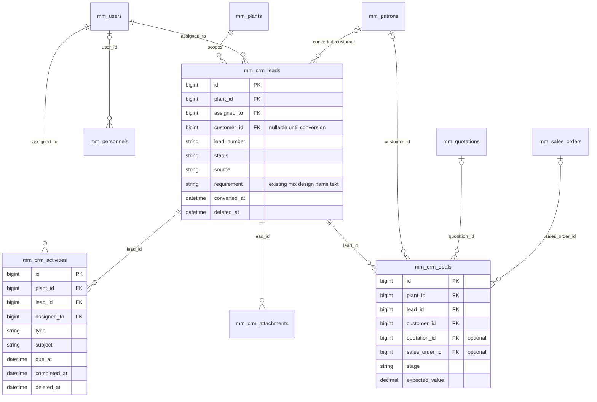
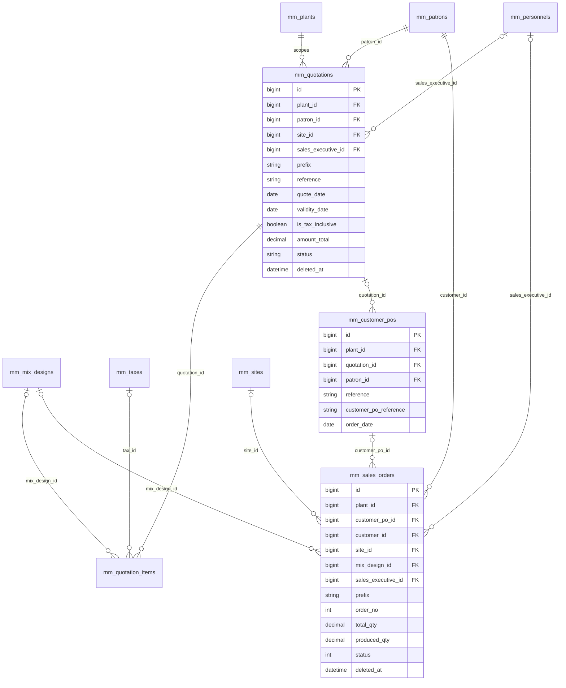
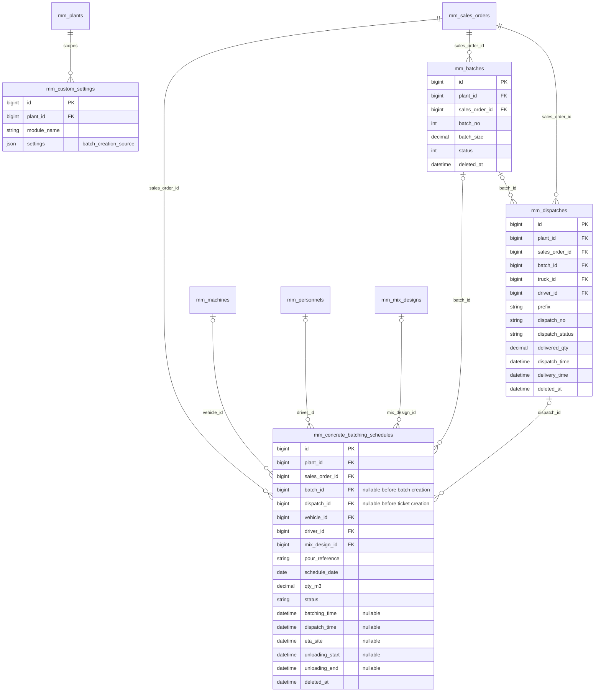
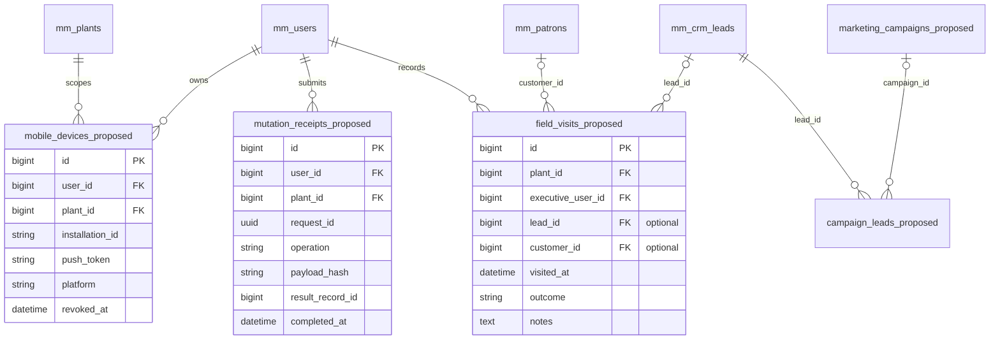

<!--
Author: ragul-onemodo
Created: 2026-10-09 17:21:49 Asia/Calcutta (UTC+05:30)
-->

# Sales Executive App ER Diagrams and Screens

The mobile app uses the existing ERP records. These diagrams describe the logical model relationships used by the app; they do not imply every relationship is enforced by a database foreign key. Proposed mobile additions are shown separately and require design review and migrations before use.

## CRM and ownership

Lead and activity owners are user IDs. Sales executive fields on commercial documents are personnel IDs. Resolve the user-to-personnel relationship before applying My Records filters. Although normal lead conversion creates one deal, the model is not shown as a database-enforced one-to-one relationship.

Existing activities belong to leads. Customer-only or order-only follow-ups need an explicit activity-model extension; the mobile API must not pretend those links already exist. The existing CRM requirement is a name string, not a mix_design_id foreign key.

## Quotations and sales orders

The commercial sequence is quotation → customer PO → sales order. Nullable links permit the ERP's existing alternative entry paths; the app should apply the existing validation rather than invent a mandatory relationship for every historical record.

## Batch schedules and delivery

The intended app workflow uses one selected schedule slot for a batch. The current schema has nullable batch_id and dispatch_id links without a unique constraint on each link, so the diagram shows possible stored cardinality rather than asserting one-to-one enforcement. Current creation validation prevents reusing a consumed slot.

Direct production selects a sales order; scheduled production selects a slot and uses that slot's sales_order_id in both batches and dispatches. Both use the same production logic. Batch numbers can be reused after soft deletion, so links use id, never batch_no as a foreign key.

## Proposed mobile additions

These table names are illustrative. Choose final names and indexes during API implementation. Scope idempotency uniqueness to user, plant and request_id; reject a retry with different payload contents. Campaign relationships are a later extension. Use the current Sanctum token storage and review existing notification facilities before adding overlapping tables.

## Mobile screen inventory

| Screen | Main content | Main actions |
|---|---|---|
| Login | User credentials, OTP if required, device state | Sign in, verify, sign out device |
| Plant selection | Authorized plants | Choose active plant |
| Dashboard | Follow-ups, lead pipeline, quotations, orders and production counts | Open filtered list, quick add |
| Lead list | Search, stage, owner, priority and next action | Add lead, open detail |
| Lead form | Contact, company, source, requirement, quantity, site and owner | Save draft, save changes |
| Lead detail | Contact, qualification, timeline, files and deal | Edit, add follow-up, qualify, convert once |
| Follow-up list | Today, overdue, upcoming and completed | Complete, reschedule, open related lead |
| Follow-up form | Type, due time, notes, owner and outcome | Save or complete |
| Marketing | Lead source performance and field visits | Add enquiry, record visit |
| Customer list | Search and assigned customers | Open customer |
| Customer detail | Contacts, sites, quotations, orders and production summary | Open order, call, add permitted activity |
| Quotation list | Reference, customer, amount and status | Add, open, filter |
| Quotation form | Customer/site, product or mix design, lines, sales tax and inclusive toggle | Save draft, update |
| Quotation detail | PDF, totals, status and downstream links | Preview, share, edit/delete when allowed |
| Customer PO | Accepted quotation/customer PO and line details | Convert through existing sales-order rules |
| Order list | Order, customer, quantity and progress | Open order, create if permitted |
| Order detail | Ordered, committed, dispatched and delivered quantities; distinct batch states | Open batches, dispatches and schedules |
| Batch schedules | Planned slots, site, mix, quantity, truck and linked batch | Create/edit planned slot where permitted |
| Schedule form | Sales order, date, logistics and optional times | Save with server availability validation |
| Batch detail | Batch number, status, quantity and linked dispatch | View operational progress |
| Notifications | Due actions, assignments and order updates | Open related record |
| More and profile | Customers, quotations, marketing, schedules and settings | Switch plant, view sync queue, sign out |

## Screen interaction rules

Use a fixed conceptual bottom navigation with Home, Leads, Follow Ups, Orders and More. On actual devices account for safe areas and keyboard behaviour. In the prototype the navigation stays in normal flow for preview accessibility.

Lead, quotation and schedule forms open as full mobile pages. Use a visible Back action, a clear Save action and field-level errors. Confirm unsaved changes when leaving a dirty form. Show whether data is a draft, pending synchronization or committed to the server.

Use optional null dates in schedule forms and display a dash for missing operational timestamps. Show batch and trip states separately. A read-only executive screen must not offer production weight or dispatch-status edits.

The interactive screen prototype uses fictional demo records. It demonstrates navigation and form layout; Save and Complete modify local demo state only. It does not call ERP APIs or create production records. Financial values are illustrative and final document calculations remain server-side.

## Design review checklist

- Confirm the phone layout, bottom navigation and placement of quotations/schedules under More.
- Confirm required lead fields and executive ownership visibility.
- Confirm which schedule and order actions executives may perform.
- Agree on labels for committed batches, completed production and delivered quantities.
- Review quotation forms with realistic long product/mix-design names.
- Test readable labels, keyboard operation, empty dates, loading, validation, no records and lost connectivity at small phone widths.

Read together with [the development plan](sales-executive-mobile-app.md). This document introduces no database migration or application API change.
